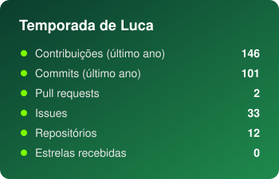
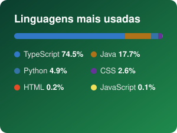

<!-- Banner do README antigo, agora nas cores de gramado -->


<div align="center">

<!-- Texto digitando (domínio atualizado: demolab.com) -->


</div>

---

## 🧾 Ficha técnica

<div align="center">

| | |
|---|---|
| 🧍 **Jogador** | Luca Moreira |
| 🏟️ **Clube atual** | Strategy2B · Analista de Projetos de TI |
| 🎓 **Categoria de base** | Engenharia de Software · PUC Minas (sobe pro profissional em jul/2028) |
| 📍 **Posição** | Meio-campo: faz a ponte entre negócio e código |
| ✈️ **Passagem internacional** | Austrália 🇦🇺 · inglês fluente, pronto pra ambiente multicultural |
| 🏆 **Histórico** | Ex-Project Manager · caçador de flags em CTF 🚩 |

</div>

### 💡 Sobre mim

- 💼 **Gestão e Tecnologia:** atuei como Project Manager e hoje sigo em projetos de TI, unindo a visão de negócio com a execução técnica.
- ⚽ **Esportes & Dados:** apaixonado por futebol e por entender como dados e tecnologia mudam o jogo.
- 🛡️ **Próximos treinos:** `arquitetura orientada a eventos` · `cibersegurança` · `análise de dados`

### 📊 Atributos

<!-- ⚠️ Ajuste as barras para a sua autoavaliação real (20 blocos = 100) -->
```text
JAVA           ██████████████████░░
JAVASCRIPT     ███████████████░░░░░
C / C++        ██████████████░░░░░░
SQL            ███████████████░░░░░
GESTÃO         █████████████████░░░
SEGURANÇA      ████████████░░░░░░░░
VISÃO DE JOGO  ████████████████░░░░   (aka modelagem e arquitetura)
```

---

## ⚽ Bate um pênalti aí!

<p align="center">
Escolha um canto. O goleiro escolhe outro (ou não 😏).<br/>
O lance aparece aqui no perfil em ~30 segundos.
</p>

<div align="center">

[](https://github.com/lucam05/Lucam05/issues/new?title=penalti%7Cesquerda&body=%E2%9A%BD+N%C3%A3o+precisa+escrever+nada%2C+%C3%A9+s%C3%B3+clicar+em+%22Create%22.%0A%0AN%C3%A3o+mude+o+t%C3%ADtulo%2C+ele+%C3%A9+o+seu+chute!)
[](https://github.com/lucam05/Lucam05/issues/new?title=penalti%7Cmeio&body=%E2%9A%BD+N%C3%A3o+precisa+escrever+nada%2C+%C3%A9+s%C3%B3+clicar+em+%22Create%22.%0A%0AN%C3%A3o+mude+o+t%C3%ADtulo%2C+ele+%C3%A9+o+seu+chute!)
[](https://github.com/lucam05/Lucam05/issues/new?title=penalti%7Cdireita&body=%E2%9A%BD+N%C3%A3o+precisa+escrever+nada%2C+%C3%A9+s%C3%B3+clicar+em+%22Create%22.%0A%0AN%C3%A3o+mude+o+t%C3%ADtulo%2C+ele+%C3%A9+o+seu+chute!)

</div>

<!-- O bloco abaixo é reescrito automaticamente pelo penalti/jogo.py. Não edite à mão. -->
<!-- PENALTI:START -->

<p align="center"></p>

<p align="center"><b>⚽ 0 gols · 🧤 0 defesas · 🚀 0 pra fora · 🎯 aproveitamento —</b></p>

<!-- PENALTI:END -->

---

## 🛠️ Tecnologias e Ferramentas

<div align="center">

**🌐 Linguagens**<br/>


**⚙️ Dados & Infraestrutura**<br/>


**💻 Ferramentas**<br/>


</div>

---

## 🎥 Melhores lances

| Lance | Descrição |
|---|---|
| ⚽ [SitemyLimeira](https://github.com/lucam05/SitemyLimeira) | Sistema de gestão de fazenda |
| ⚽ [trabalho_aed1_hotelDescanso](https://github.com/lucam05/trabalho_aed1_hotelDescanso) | O primeiro gol: trabalho de AEDs I |
<!-- TODO: adicionar os projetos mais recentes aqui -->

---

## 📈 Estatísticas da temporada

<div align="center">
  <!-- Gerados todo dia pelo workflow stats.yml (sem depender de serviço externo) -->
  
  
</div>

<!-- Cobrinha comendo as contribuições (precisa do workflow snake.yml rodar uma vez) -->
<p align="center">
  <picture>
    <source media="(prefers-color-scheme: dark)" srcset="https://raw.githubusercontent.com/lucam05/Lucam05/output/github-snake-dark.svg"/>
    
  </picture>
</p>

---

<div align="center">

### 📞 Proposta de transferência? Vamos nos conectar!

<a href="https://www.linkedin.com/in/luca-de-araujo/"></a>
<a href="https://github.com/lucam05"></a>
<a href="https://www.instagram.com/05luca/"></a>

</div>


